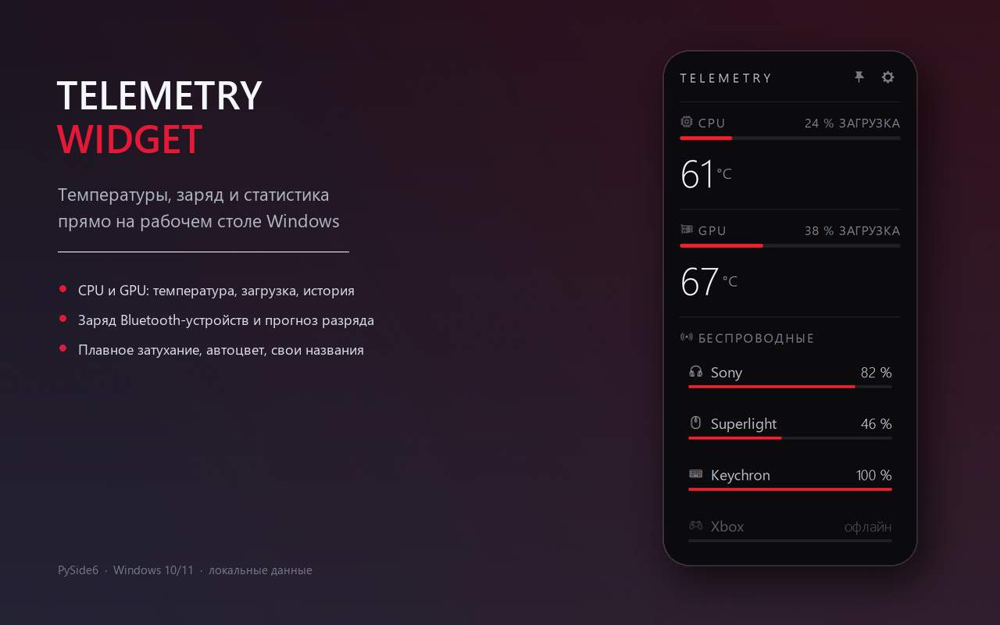
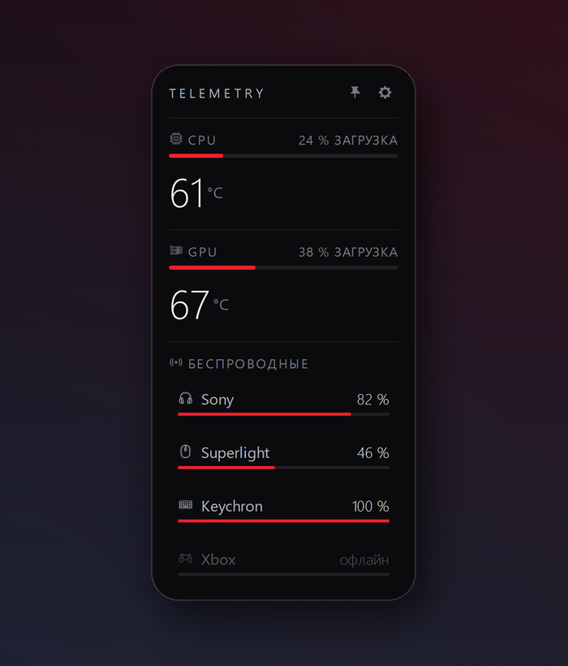
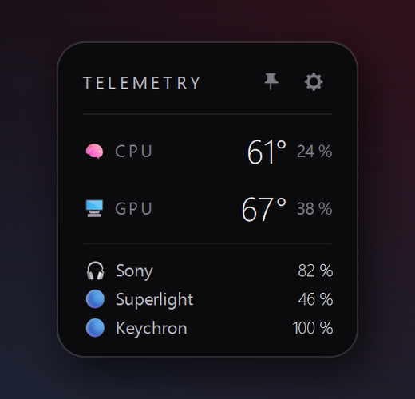
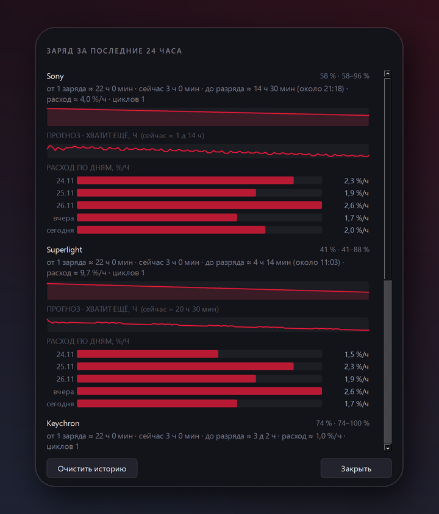
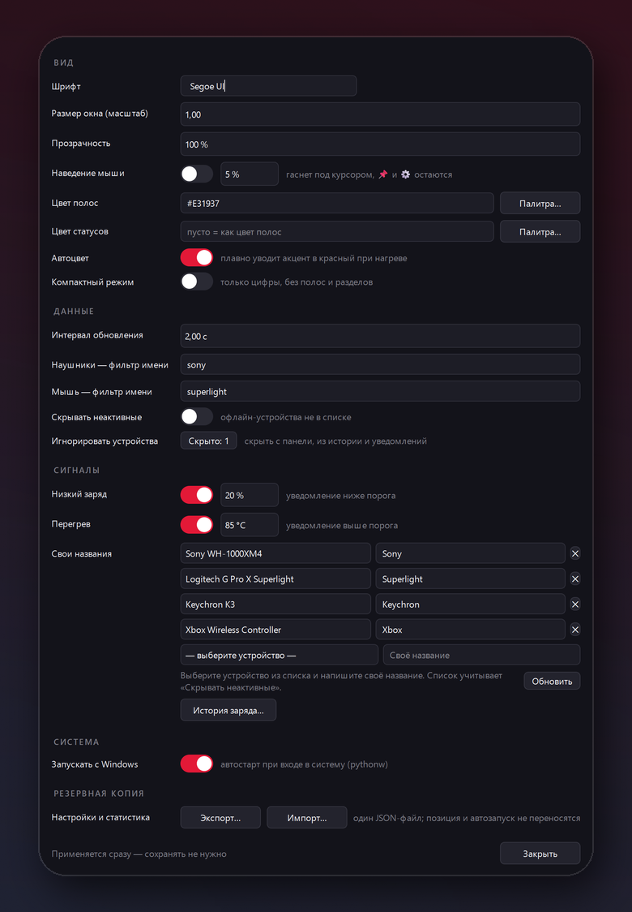

# Telemetry Widget

**Тёмный виджет рабочего стола для Windows: температуры CPU/GPU, заряд Bluetooth-устройств, история и прогноз разряда — в одной стеклянной панели.**

<p align="center">
  
</p>

<p align="center">
  
  
  
  
  
</p>

> **EN** — A dark, always-on-top Windows desktop widget with CPU/GPU temperatures,
> Bluetooth battery levels, 24-hour and 7-day charge history, discharge forecast and
> per-day battery rates. PySide6, local-only data, no telemetry.

Тёмная стеклянная панель в стиле Tesla / Apple, которая живёт на рабочем столе и показывает:

- 🌡 температуру CPU и GPU
- 📊 загрузку CPU и GPU
- 🎧 заряд Bluetooth-наушников
- 🖱 заряд Bluetooth-мышки
- 🔔 уведомления о низком заряде и перегреве
- 📈 историю заряда за сутки и за неделю
- ⏱ статистику: сколько устройство работает от одной зарядки, прогноз разряда и
  остаток времени прямо в строке устройства
- 🖱 карточку устройства под курсором: спарклайн, расход и остаток
- 🎨 автоцвет акцента: от спокойного к красному при нагреве и нагрузке
- 🌘 три темы (тёмная, графит, светлая) и следование теме Windows
- 🫥 автоскрытие в полноэкранных играх — с закладкой у края монитора

Перетаскивается мышкой. Виджет **всегда отображается поверх всех окон** —
он сам удерживает верхний слой: при старте, при запуске других программ
и проверкой раз в 3 секунды.
Настраивается по правому клику или шестерёнке в строке TELEMETRY: шрифт, размер (масштаб),
прозрачность, затухание под курсором, цвет полос и статусов, автоцвет, интервал обновления,
компактный режим, автозапуск с Windows, пороги уведомлений, свои названия и
игнорируемые устройства, экспорт/импорт настроек и статистики.

## Скриншоты

<table>
  <tr>
    <td align="center"><br><sub>Полный режим</sub></td>
    <td align="center"><br><sub>Компактный режим</sub></td>
  </tr>
  <tr>
    <td align="center"><br><sub>История, прогноз и расход по дням</sub></td>
    <td align="center"><br><sub>Настройки</sub></td>
  </tr>
</table>

> На скриншотах — синтетические демонстрационные данные. Реальные имена
> устройств, позиция окна и статистика в репозиторий не попадают.

> **Настройки применяются сразу.** Ползунок/поле меняются — виджет тут же
> становится таким, как нарисовано. Кнопки «Сохранить» нет, окно настроек
> можно просто закрыть.

> **В закреплённом режиме настройки недоступны.** Пока виджет «закреплён»
> (клик-сквозной режим), шестерёнка приглушена и не реагирует на клик:
> сначала снимите закрепление удержанием 📌.

> **Наведение мыши.** В закреплённом режиме панель под курсором плавно тает
> почти до прозрачности (по умолчанию 5 %), чтобы видеть и нажимать окна под
> ней. 📌 и ⚙ при этом остаются полностью видимыми. Настройка — «Наведение
> мыши» в настройках; затухание можно выключить или задать свой порог.

## Автоцвет

В настройках → **Вид** есть тумблер **«Автоцвет»** (включён по умолчанию).
Акцентный цвет плавно, за 0,65 секунды, уходит от выбранного спокойного цвета
к красному, когда растёт температура CPU/GPU или загрузка. Температура важнее
нагрузки: полный красный — на пороге перегрева (или 90 °C, если уведомления о
перегреве выключены), а 100 % загрузки дают примерно 70 % перехода.

Автоцвет меняет полоски загрузки и заряда, «горячие» проценты температуры,
низкий заряд и кнопку 📌; иконка в трее обновляется, когда переход завершён.
Выключите тумблер — акцент снова станет ровно тем цветом, который выбран
полем «Цвет полос». Если сам акцент уже красный, переход к красному менее
заметен: для выразительного эффекта выберите спокойный синий или зелёный.

Рядом есть поле **«Цвет статусов»** — им окрашиваются статусные подписи:
процент при низком заряде устройства и температура при перегреве. Оставьте
поле пустым, и они будут брать «Цвет полос» вместе с автоцветом (как раньше);
свой цвет не участвует в автоцвете и всегда остаётся одинаковым.

Две иконки встроены в строку **TELEMETRY** (справа) — они нарисованы вектором,
без эмодзи:

| Иконка | Что делает |
|---|---|
| Канцелярская кнопка (pin) | Одиночный клик — включить **клик-сквозной режим**: клики проходят сквозь виджет к окнам под ним, кликабельной остаётся только сама кнопка 📌 (шестерёнка при этом гаснет и недоступна). Пока режим включён, иконка **горит акцентным цветом** (без заливки кнопки). Чтобы **выключить** — удерживайте её: кнопка **отсчитывает секунды 5 → 0**, на нуле режим снимается (защита от ложных нажатий). Отпустили раньше — отсчёт отменяется. |
| Шестерёнка | Открыть настройки. В закреплённом (клик-сквозном) режиме **недоступна**: иконка приглушена, а клик по ней проходит сквозь виджет. Сначала снимите закрепление. |

## Компактный режим

В настройках есть переключатель **«Компактный режим»** — виджет превращается
в маленькую панель (около 210×280 вместо 264×645):

- только цифры: `🧠 CPU 53° 17 %`, `🖥 GPU 47° 4 %` — без крупных значений и полос;
- устройства списком в одну строку: `🎧 RB-M500B 84 %`;
- окно остаётся поверх всех окон и так же перетаскивается.

Переключить можно и без настроек: правый клик по виджету →
**◱ Компактный режим** (галочка показывает текущее состояние).

## Автозапуск

В настройках → **Система** → ползунок **«Запускать с Windows»** (по умолчанию
**выключен**, состояние читается из реестра). Переключается сразу, без
подтверждения: включает запись в `HKCU\…\CurrentVersion\Run`, запуск идёт через
`pythonw.exe` — без окна консоли. Если папку виджета перенести, путь в реестре
обновится при следующем запуске.

## Иконка в трее

Пока виджет работает, рядом с часами есть его иконка (канцелярская кнопка
акцентного цвета). Меню по правому клику:

- **Скрыть / Показать виджет** — то же делает одиночный клик по иконке;
  двойной клик открывает настройки;
- **Настройки…**, **История заряда…**;
- **Закрепить поверх окон** и **Компактный режим** — те же режимы, что 📌 и
  правый клик по виджету (галочка показывает состояние);
- **Выход**.

Трей особенно удобен в закреплённом режиме: виджет не принимает мышь, а через
иконку его всегда можно показать или скрыть. Подсказка при наведении на иконку
показывает текущие значения: `Telemetry · CPU 12 % / 48 °C · GPU 20 % / 55 °C`.

## Уведомления

В настройках → **Сигналы** два независимых порога:

- **Низкий заряд** — всплывающее уведомление Windows, когда заряд устройства
  опускается до порога (по умолчанию 20 %). Повторно об устройстве не
  напоминаем, пока заряд не поднимется выше порога на 5 % и снова не упадёт,
  либо пока устройство не отключится и не подключится снова.
- **Перегрев** — уведомление, когда температура CPU или GPU достигает порога
  (по умолчанию 85 °C). Температура в виджете подсвечивается акцентным цветом.
  Повторное срабатывание — только после остывания на 5 °C.

Оба порога можно выключить тумблером. Уведомления идут через иконку в трее,
то есть работают и когда виджет скрыт.

## История заряда

Виджет запоминает заряд устройств в `history.json`. Сутки пишутся подробно
(точка раз в 5 минут), а всё, что старше, прореживается до одной точки в
30 минут — так хранится **неделя** истории, а файл остаётся маленьким.
Посмотреть: **История заряда…** в трее, в правом клике по виджету или кнопкой
в настройках.

В окне истории для каждого устройства — мини-график, текущий, минимальный и
максимальный заряд. Переключатель **«24 ч / 7 дней»** справа сверху меняет
диапазон графика: сутки подробно или вся неделя. Там же — статистика работы от зарядки:
среднее время цикла, время текущего цикла, расход в %/час и оценка «до разряда»
с примерным временем. Историю и статистику можно очистить одной кнопкой.

Под графиком заряда рисуется **прогноз «сколько ещё протянёт»**: для каждой
точки за сутки виджет смотрит на расход за предыдущие два часа и показывает,
на сколько часов хватило бы заряда при такой скорости. Рядом — **расход по
дням** за последнюю неделю (средние %/час; сегодня и вчера подписаны словами).
Дневная статистика хранится в `stats.json` до 60 дней. Пока данных мало,
прогноз и дни просто не показываются — они накапливаются по мере работы.

### Сколько устройство работает от одной зарядки

Статистика хранится отдельно, в `stats.json`:

- цикл начинается, когда устройство впервые появилось онлайн, и заканчивается,
  когда заряд **вырос на 2 % и больше** — значит, его поставили на зарядку;
- засчитывается только время, пока устройство онлайн и виджет работает;
  паузы длиннее 2,5 минут (устройство спало или виджет был выключен) не
  считаются;
- в среднее идут циклы не короче 10 минут с реальным разрядом от 5 %;
- оценка «до разряда» считается по скорости разряда текущего цикла, а пока
  цикл совсем новый — по среднему прошлых циклов;
- данные устройства, которое не появлялось больше года, удаляются сами.

## Привязка к монитору

Виджет запоминает, на каком мониторе стоит, и после перезапуска возвращается
туда же. Если монитор отключить (или изменить разрешение), виджет не уезжает
за край экрана: привязка к пропавшему монитору сбрасывается на основной, а
позиция поправляется в пределах рабочего стола.

## Свои названия устройств

В настройках → **Свои названия** системные имена заменяются понятными
подписями. Ничего вводить вручную не нужно: устройство выбирается из
выпадающего списка, рядом пишется своё название.

- В списке — устройства, которые сейчас онлайн. Если выключить
  **«Скрывать неактивные»**, в список попадут и офлайн-устройства (например,
  наушники в кейсе).
- Последняя строка всегда пустая: выбрали устройство — появилась новая пустая
  строка, можно сразу добавить следующее.
- **✕** справа убирает название и возвращает системное имя.
- Одно и то же устройство нельзя добавить дважды — уже выбранные исключены из
  остальных списков.
- Названия подставляются в виджете и в истории заряда; определять тип
  устройства (🎧/🖱) виджет продолжает по системному имени.

Это особенно удобно для устройств с нечитаемыми (китайскими) именами: выбираете
строку в списке и пишете «Наушники» — запоминать системное имя не нужно.
Старые записи, сохранённые по части имени, автоматически подставляются на
живое имя устройства.

## Игнорируемые устройства

Настройки → **Данные** → **«Игнорировать устройства»**. Нажмите кнопку и
отметьте устройства, которые не нужны на панели. Они исчезнут из виджета, из
истории заряда, из уведомлений о низком заряде и перестанут попадать в
статистику (уже накопленные данные остаются в файле, но не показываются).
Вернуть устройство можно там же: список всегда содержит и скрытые устройства.

Игнорирование хранится по системному имени, поэтому не зависит от «своего
названия». В меню видно и то и другое: `Panasonic (RB-M500B)`.

## Пороги, порядок и «забыть устройство»

Настройки → **«Устройства: пороги и порядок…»**:

- **Своя строка у каждого устройства** — порог низкого заряда можно задать
  отдельно (5/10/15/20/30/50 %), а можно выбрать «общий» (из настроек
  сигналов) или «не следить». Своя цифра важнее общей: наушники можно
  предупреждать на 30 %, а мышь — на 10 %.
- **Стрелки ↑ ↓** задают порядок строк в панели; «Сбросить порядок»
  возвращает автоматический (наушники, мышь, остальные). Офлайн-устройства
  остаются в конце списка при любом порядке.
- **«Забыть»** удаляет историю заряда, статистику циклов, своё название,
  порог и позицию в списке. Пока устройство подключено, данные просто
  начнутся заново.

Дополнительно в настройках есть **«Забывать невидимые»**: устройства, которые
не появлялись дольше N дней (по умолчанию 90), удаляются автоматически.
«Никогда» отключает чистку.

## Карточка устройства

Наведите курсор на строку устройства — рядом с панелью появится карточка:
заряд, спарклайн за сутки, расход в %/час, «до разряда ≈» и среднее время
работы от одной зарядки. Карточка выезжает слева, а если там нет места —
справа, и никогда не выходит за край монитора. Выключается в настройках →
**«Карточка устройства»**. В клик-сквозном (закреплённом) режиме карточка не
появляется: там панель гаснет под курсором.

## Темы

Настройки → **Вид → Тема**: **Тёмная** (по умолчанию), **Графит**,
**Светлая** и **«Как в Windows»** — последняя читает `AppsUseLightTheme` и
переключается вместе с оформлением системы. Цвет полос и статусов
(и автоцвет) работают поверх любой темы. Виджет перекрашивается сразу;
окно настроек подхватит новую тему при следующем открытии.

## Автоскрытие

Настройки → **Система → «Автоскрытие»**. Включённая панель убирается к краю
монитора, оставляя узкую акцентную закладку. В строке **«Когда прятать»** два
режима:

- **Только в полноэкранных играх** (по умолчанию) — прячется, когда на том же
  мониторе, где стоит виджет, появляется полноэкранное окно (игра, видео,
  презентация). Панель остаётся на виду в обычной работе.
- **Всегда, когда не наведена** — рабочий стол без виджета: панель живёт в
  закладке у края и выезжает только под курсором или кликом по закладке.
  Перетаскивание панели её не прячет, пока кнопка мыши зажата.

Общее для обоих режимов:

- Панель **плавно выезжает** из-за края (240 мс) и так же плавно заезжает
  обратно.
- Наведение курсора (0.7 с) или клик по закладке — панель выезжает. Стоит
  убрать мышь — панель стоит ещё **«Прятать через»** секунд (по умолчанию 8,
  настраивается 1–60) и только потом уезжает. Вернули курсор — отсчёт
  начинается заново.
- **Закладку можно перетащить** мышью вдоль края на любое место (её положение
  запоминается отдельно, `tab_y`). На место выезда панели это никак не влияет:
  виджет всегда выезжает там, где его поставили.
- Игра закрылась — виджет возвращается на прежнее место.
- Сторона выбирается в настройках (**ближайшая**, левая или правая), по
  умолчанию — ближайшая к текущему положению виджета.
- Всё зажато в пределах **своего** монитора: при двух экранах виджет не может
  «переехать» на соседний, а игра на втором мониторе ничего не прячет.
- Во время скрытия `pos` в конфиге не перезаписывается — виджет не запомнит
  положение «за краем экрана».

## Обновления

Настройки → **Система → «Проверять обновления»** (включено по умолчанию).
Раз в 4 часа виджет читает `version.json` из репозитория; обновиться можно и
вручную: трей → **«Проверить обновления»**.

Схема безопасная, без «тихого» запуска кода с GitHub:

1. В `version.json` лежит версия, ссылка на архив релиза и **SHA-256**.
2. Виджет скачивает архив и сверяет контрольную сумму. Не совпала —
   обновление отклоняется.
3. Проверенный архив распаковывается в `updates/pending/`, в трее появляется
   пункт **«Обновить до X и перезапустить»**.
4. При нажатии файлы копируются поверх установленных, `VERSION` обновляется,
   виджет перезапускается. `config.json`, `history.json` и `stats.json`
   не перезаписываются никогда.

Сборка релиза: `python tools/make_release.py 1.2.0 "что нового"` — соберёт
`dist/widget-1.2.0.zip`, посчитает SHA-256 и обновит `version.json`.

## Резервная копия

Настройки → **«Резервная копия»**:

- **Экспорт…** — сохраняет в один JSON-файл настройки, историю заряда
  (вся неделя) и статистику циклов/дней. Удобно перед переустановкой или переносом на
  другой компьютер.
- **Импорт…** — заменяет текущие настройки и статистику данными из файла.
  Перед заменой виджет спросит подтверждение. Позиция окна, привязка к монитору,
  автозапуск и режим закрепления не импортируются — они относятся к конкретной
  машине и текущему сеансу.

## Быстрый старт

Нужен **Windows 10/11** и **Python 3.10+** с `pip`.

### Вариант 1 — готовые .bat

1. Скачайте репозиторий (Code → Download ZIP) и распакуйте в любую папку.
2. Запустите **«Установить зависимости.bat»** — установятся PySide6, psutil и nvidia-ml-py.
3. Запустите **«Запуск виджета.bat»** — виджет появится в правом верхнем углу.
4. Правый клик по виджету → **Настройки** (шрифт, масштаб, прозрачность, автозапуск и т.д.).

### Вариант 2 — вручную

```powershell
git clone https://github.com/serhiigad/telemetry-widget.git
cd telemetry-widget
python -m pip install -r requirements.txt
python app.py
```

Для повседневного запуска без окна консоли используйте `pythonw app.py`
или `Запуск виджета.bat`. Первый запуск создаёт `config.json` рядом с `app.py`;
готовый пример настроек лежит в `config.example.json`.

## Данные и приватность

Виджет не отправляет данные в интернет. Всё хранится локально, рядом с программой:

- `config.json` — настройки, позиция, свои названия устройств;
- `history.json` — точки заряда за последние 24 часа (шаг 5 минут);
- `stats.json` — циклы зарядки и средний расход по дням (до 60 дней).

Эти три файла добавлены в `.gitignore`: в репозитории нет личных имён устройств,
позиции окна и истории использования. Если нужен перенос на другой компьютер —
используйте **Экспорт…** в настройках: получится один JSON-файл с настройками и
статистикой.

Температуры читаются локально: из LibreHardwareMonitor на
`http://127.0.0.1:8085/data.json`, через NVML для NVIDIA или ACPI Thermal Zone.
Сетевых запросов наружу нет.

## Температуры CPU и GPU

Windows не отдаёт температуры процессора/видеокарты без драйвера ядра, поэтому:

**Рекомендуемый способ — LibreHardwareMonitor (точные значения):**

1. Скачайте: https://github.com/LibreHardwareMonitor/LibreHardwareMonitor/releases
   (файл `LibreHardwareMonitor-net472.zip`), распакуйте в любую папку, например `C:\LHM`.
2. Запустите `LibreHardwareMonitor.exe` **от имени администратора**.
3. В меню: **Опции → Веб-сервер** — включите (порт 8085, как есть).
4. Готово — виджет сам подхватит данные с `http://127.0.0.1:8085`.

Без LHM виджет попробует: данные NVIDIA (pynvml) для GPU и ACPI Thermal Zone для CPU
(есть не на всех материнских платах — тогда будет прочерк «—»).

**Почему без LHM на этой машине прочерки.** CPU-температуру Windows отдаёт только
через ACPI-зону (`MSAcpi_ThermalZoneTemperature`), а она требует прав администратора —
без них система возвращает «доступ запрещён». GPU — Radeon RX 6600 XT: AMD-драйвер
(ADL, Overdrive5/6) и встроенный `D3DKMTQueryAdapterInfo` на этой карте температуру
не возвращают вовсе (ошибка «не поддерживается» / константы вместо значений).
Итог: без сторонней программы с драйвером ядра (как LHM) честной температуры нет —
виджет показывает «—», остальное (загрузка CPU, заряд устройств) работает и так.

Чтобы LHM стартовал сам, добавьте его ярлык в
`Win+R → shell:startup` (запуск от администратора: свойства ярлыка → Дополнительно).

## Заряд Bluetooth-устройств

Виджет читает заряд через свойство PnP-устройств Windows 10/11 («Battery Level»).
Работает для устройств, которые сами сообщают заряд (наушники с поддержкой ABS, мыши с BLE).

- Список «📶 БЕСПРОВОДНЫЕ» показывает **все спаренные Bluetooth-устройства**: у каждого
  своя иконка (🎧 наушники, 🖱 мышь, ⌨ клавиатура, 🎮 геймпад, 🔊 колонка, 🔵 прочее).
  Разделы CPU и GPU тоже с иконками: 🧠 процессор и 🖥 видеокарта.
- Подключённые — вверху списка; **офлайн — в конце, приглушённым серым** с пометкой
  «офлайн».
- В настройках есть переключатель **«Скрывать неактивные устройства»**.
- В строке устройства видно, **на сколько ещё хватит заряда**: справа от
  полоски — «≈ 6 ч 20 мин», в компактном режиме — второй строкой «≈ 6 ч».
  Оценка берётся из статистики циклов разряда (см. ниже) и появляется, когда
  данных хватит;
  пока её нет, строка остаётся как раньше. Точная оценка с временем разряда и
  расходом — в окне «История заряда».
- Если показывать нечего, раздел «📶 БЕСПРОВОДНЫЕ» **скрывается целиком** —
  вместе с заголовком и разделителем (высота панели сжимается). Так виджет
  выглядит и при включённом «Скрывать неактивные», когда ни одно устройство
  сейчас не подключено.
- Виджет сам угадывает, где наушники, а где мышь. Если нужно точнее: настройки →
  впишите часть имени устройства (например `Sony` или `MX Master`).

## Чем отличается от BatteryHub (Wireless-Device-Battery-Monitor)

BatteryHub — трей-приложение, которое опрашивает вендорские HID-протоколы
(Logitech, Razer, SteelSeries и т.п.) и ведёт историю заряда. У этого виджета
другая задача — тихая панель на рабочем столе с температурами и зарядом.

Что из BatteryHub здесь уже есть: **график/история заряда**, **статистика
работы от одной зарядки**, **уведомления о низком заряде** и **свои названия
устройств**. Вендорские протоколы переносить
смысла нет: все Bluetooth-устройства на этой машине (наушники, мышь,
клавиатура) сами отдают заряд через Windows, а протоколы нужны для
USB-донглов конкретных брендов (Logitech Bolt/Unifying и подобных).

## Структура проекта

| Файл | Назначение |
|---|---|
| `app.py` | интерфейс виджета, настройки, трей, автоцвет, резервные копии |
| `monitor.py` | сбор данных: температуры, загрузка, Bluetooth-устройства |
| `history.py` | история заряда (сутки подробно, неделя прореженно), циклы и статистика по дням |
| `updater.py` | проверка, скачивание и установка обновлений с SHA-256 |
| `VERSION`, `version.json` | текущая версия и манифест обновления |
| `assets/icons/` | иконки 64×64 (белые PNG, тонируются кодом) |
| `config.example.json` | пример настроек (рабочий `config.json` создаётся сам) |
| `config.json` | локальные настройки — **не в git** |
| `history.json` | история заряда за неделю — **не в git** |
| `stats.json` | статистика работы от зарядки — **не в git** |
| `Запуск виджета.bat` | старт через `pythonw` (без окна консоли) |
| `Установить зависимости.bat` | установка библиотек |
| `requirements.txt` | зависимости приложения |
| `requirements-dev.txt` | Pillow для генерации скриншотов |
| `screenshots/` | изображения для README |
| `tools/make_screenshots.py` | генерация скриншотов на синтетических данных |
| `tools/import_icons.py` | нарезка листа иконок `iconpack.png` по ячейкам |
| `tools/make_release.py` | архив релиза, SHA-256 и `version.json` |
| `updates/` | скачанные обновления — **не в git** |

## Частые вопросы

**Как передвинуть виджет?** В обычном режиме — просто перетащить.
В клик-сквозном режиме виджет не принимает мышь: сначала снимите закрепление
(удерживая кнопку-пин до нуля), передвиньте и закрепите снова.

**Как убрать клик-сквозной режим?** Наведите курсор на кнопку 📌 в строке
TELEMETRY (она подсвечивается и остаётся кликабельной) и удерживайте её — кнопка
отсчитает 5, 4, 3, 2, 1, 0, и режим выключится. Это защита от случайных нажатий.

**Почему иконки работают, хотя клики проходят сквозь виджет?** В клик-сквозном
режиме окно помечено как «прозрачное» для мыши, но виджет ставит системный хук
`WH_MOUSE_LL`: он смотрит координаты нажатия и перехватывает только клики по 📌
(она нужна, чтобы снять закрепление). Клики по ⚙ и по остальной панели уходят
в окна под виджетом. Хук снимается, как только режим выключен или открыто окно
настроек.

**Почему шестерёнка серая и не открывает настройки?** Виджет закреплён
(клик-сквозной режим). В нём настройки специально недоступны, чтобы случайный
клик не раскрывал окно поверх всех окон: удерживайте 📌 до нуля — закрепление
снимется, шестерёнка снова станет активной.

**Закрыл настройки — виджет пропал.** Не должен: окно настроек закрывается
крестиком или кнопкой «Закрыть», а виджет продолжает работать. Чтобы выключить
виджет совсем — правый клик по нему → **Выход** (или то же в меню иконки в трее).

**Виджет исчез с рабочего стола.** Проверьте иконку в трее: одиночный клик по
ней показывает/скрывает виджет. Если виджет «закреплён», мышью его не вернуть —
только через трей.

**Устройство называется непонятно (например, `RB-M500B` или иероглифами).**
Настройки → **Свои названия**: выберите устройство из выпадающего списка и
напишите рядом «Наушники». Вводить системное имя не нужно.

**Виджет исчез, когда запустилась игра.** Так работает **автоскрытие**: у края
монитора остаётся узкая закладка. Наведите на неё мышь или кликните — виджет
выедет обратно; после закрытия игры он вернётся сам. Выключить или сменить
режим — Настройки → Система → «Автоскрытие» → «Когда прятать».

**История была за сутки, а стала за неделю.** Точки старше суток теперь
прореживаются до одной в 30 минут и хранятся 7 дней; сам график
переключается кнопками «24 ч / 7 дней» в окне истории.

**Как обновиться?** Трей → «Проверить обновления». Если версия новее, архив
скачается и проверится по SHA-256, после чего в меню появится
«Обновить до X и перезапустить». Настройки, история и статистика сохраняются.

**Игра на весь экран перекрыла виджет.** Виджет сам возвращается наверх:
при запуске игры, при смене активного окна и проверкой раз в 3 секунды.
Если игра работает в **эксклюзивном полноэкранном режиме** (exclusive
fullscreen), поверх неё не может рисовать ни одно окно в Windows — включите
в игре режим «в окне без рамки» (borderless) или сверните её. Повторно
закреплять 📌 больше не нужно.

**Виджет закрылся сам / пропал без сообщения.** Рядом с `app.py` появится
`widget-error.log` с текстом ошибки — пришлите его, это сразу покажет причину.
Файл создаётся только при сбое и в git не попадает.

**Запустил виджет второй раз — что будет?** Вторая копия не откроется: уже
работающий виджет мигнёт и покажет подсказку «Виджет уже запущен», а лишний
процесс сразу завершится. Одна копия на сеанс Windows — поэтому двойной клик
по `Запуск виджета.bat` при автозапуске ничего не ломает.

**Не видна зарядка, пока наушники в кейсе** — это поведение Windows: пока устройство
не передаёт заряд, данных нет.

**Почему «от 1 заряда» появилось не сразу?** Нужен хотя бы один полный цикл:
устройство должно разрядиться и снова зарядиться, пока виджет работает. Пока
цикл один, в истории видно только текущее время и оценку «до разряда».

## Лицензия

[MIT](LICENSE) © 2026 serhiigad.

Проект использует [PySide6](https://www.qt.io/qt-for-python) (LGPLv3),
[psutil](https://github.com/giampaolo/psutil) (BSD-3-Clause) и
[nvidia-ml-py](https://pypi.org/project/nvidia-ml-py/) (BSD-3-Clause).
